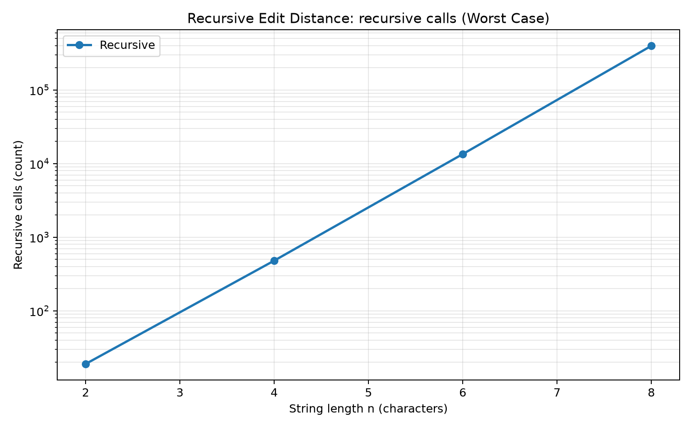
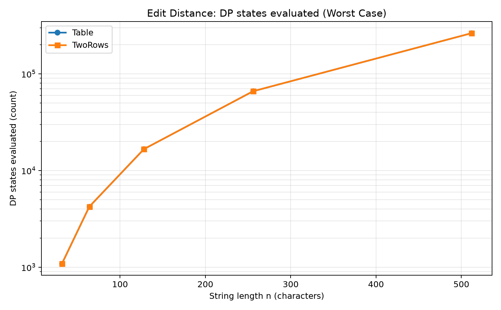
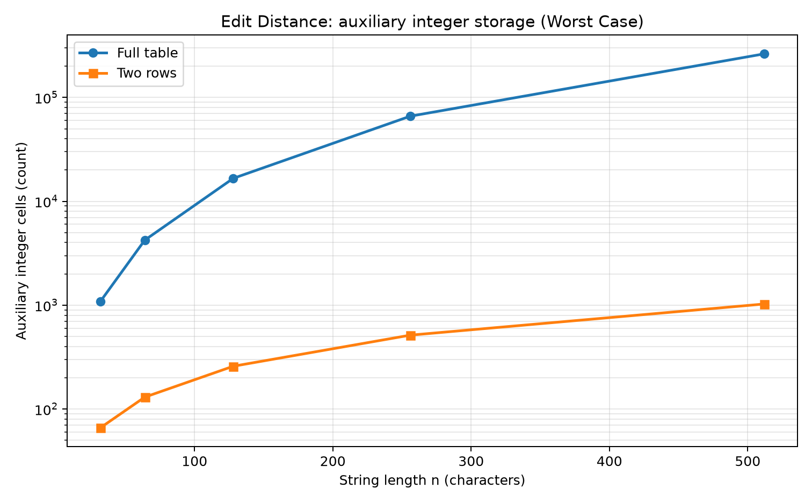
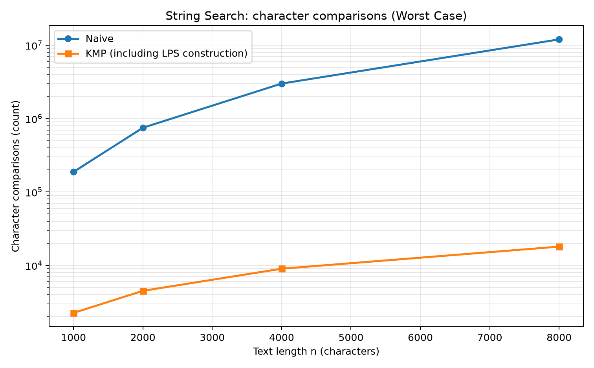
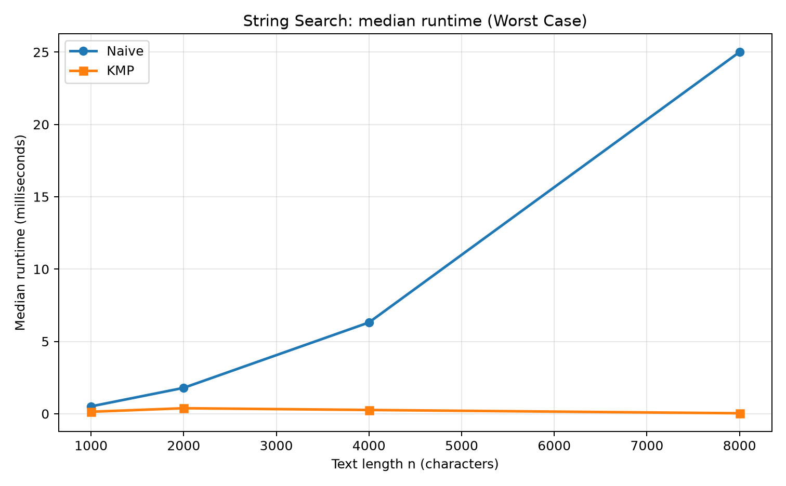

# Assignment 4 — Dynamic Programming and String Algorithms

**Student:** Alikhan Temirkhanov  
**Group:** SE-2516  
**Instructor:** Taubakabyl Nurlybek  

## 1. Experiment Design Card

| Field | Edit Distance | String Search |
|---|---|---|
| **Question** | How do recursive calls, DP states and auxiliary memory grow, and what is saved by keeping only two rows? | How do character comparisons and runtime change between an early-mismatch input and a long-prefix worst case? |
| **Sizes (n)** | Recursive: 2, 4, 6, 8. Table and TwoRows: 32, 64, 128, 256, 512. Recursive sizes are intentionally smaller because direct recursion has exponential growth. | Text lengths: 1,000, 2,000, 4,000, 8,000. Pattern length `m = n / 4`. |
| **Inputs** | `Random`: strings generated from `ABCDE` using a fixed seed. `WorstCase`: `A...A` versus `B...B`, so the last characters never match and recursion explores its branching alternatives. | `BestCase`: text is all `A`; pattern starts with `B`, so Naive fails at its first comparison at each start. `WorstCase`: text is all `A`; pattern is `A...(m-1)...AB`, so Naive compares a long common prefix at every start before failing. |
| **Metrics** | Recursive calls for Recursive; DP cells initialized/computed for Table and TwoRows; auxiliary integer cells allocated; median of five elapsed-time measurements in ms. | Character comparisons (KMP includes LPS construction); auxiliary integer cells (LPS array for KMP); median of five elapsed-time measurements in ms. |
| **Prediction** | Recursive calls should grow very quickly on mismatching inputs. Table and TwoRows should evaluate the same quadratic number of DP states. TwoRows should use linear rather than quadratic auxiliary integer storage. | Naive should be much worse on the long-prefix input, approaching O(n·m). KMP should remain O(n+m). Naive may be competitive on early mismatches because it does very little work per start. |
| **Plots** | `recursive_ops.png`: growth of direct recursion. `dp_ops.png`: DP states versus n. `dp_memory.png`: full-table versus two-row storage. | `search_ops.png`: comparison counts on the worst case. `search_time.png`: measured median time on the worst case. |

**Reproducibility:** `ExperimentRunner` uses Java `Random` with seed `20261108`. Every combination has two unrecorded warm-up calls followed by five recorded runs. `results/results.csv` contains one row per recorded run (220 data rows). Re-running the same command regenerates the same inputs and operation counts; wall-clock time can vary by computer and JVM state.

## 2. Plots and Results

### Edit Distance



*Takeaway:* On the all-mismatch input, the number of recursive calls rises from 19 at n=2 to 398,593 at n=8, illustrating why the no-memoization version must use much smaller input sizes.



*Takeaway:* Table and TwoRows evaluate the same `(n+1) × (n+1)` DP states; reducing memory does not remove the quadratic computation.



*Takeaway:* At n=512, the full table allocates 263,169 integer cells, while TwoRows allocates 1,026, showing the expected O(n²) versus O(n) auxiliary storage.

For the largest DP size (n=512, worst-case input), the median measured times in this run were approximately **1.40 ms** for Table and **1.26 ms** for TwoRows. The operation counts were both 263,169. Small timing differences should not be treated as a universal speed guarantee; the clear structural difference is memory use.

### String Search



*Takeaway:* At text length 8,000 on the long-prefix input, Naive made 12,002,000 character comparisons, while KMP made 17,998 including LPS construction.



*Takeaway:* On the same n=8,000 worst-case input, the median was 25.01 ms for Naive and 0.03 ms for KMP; the exact time ratio depends on the machine.

At n=8,000 on the `BestCase` input, Naive made 6,001 comparisons, while KMP made 9,999 including LPS construction. This is expected: Naive immediately rejects every candidate, while KMP first builds its LPS array. The worst-case input is therefore essential for a fair comparison of the algorithms' guarantees.

## 3. Prediction vs Result

**Edit Distance.** The prediction was confirmed. The recursive version grew from 19 calls at n=2 to 398,593 calls at n=8 on the worst-case input. The bottom-up versions evaluated exactly `(n+1)²` states for equal-length strings. Table and TwoRows had the same operation count, but their auxiliary integer storage differed substantially: at n=512, 263,169 versus 1,026 cells.

**String Search.** The prediction was confirmed by the operation counter. On the worst-case input, Naive's comparisons grew from 187,750 at n=1,000 to 12,002,000 at n=8,000. KMP grew from 2,248 to 17,998 comparisons, including preprocessing. On the early-mismatch input, Naive was cheaper, which is why input type matters when interpreting a benchmark.

## 4. Short Answers

**Which input made your string search slowest, and why does it do that?** The slowest input for Naive was a text containing only `A` characters and a pattern containing many `A` characters followed by `B`. At every starting position, the algorithm matches almost the whole pattern and fails only at its final character. It therefore repeats nearly `m` comparisons at roughly `n-m+1` positions, producing O(n·m) work. KMP reuses prefix information instead of repeating those comparisons.

**How large an n could the recursive Edit Distance handle, and what stopped it?** In this experiment I measured the recursive version up to n=8, where the worst-case input already required 398,593 recursive calls. I kept the size small because the direct recurrence branches into multiple recursive calls and repeats subproblems. The exponential growth, rather than an incorrect answer, is the reason larger sizes were excluded from the experiment.

**What do you gain and what do you lose when you use two rows instead of the full table?** TwoRows reduces auxiliary integer storage from O(n·m) to O(min(n,m)) while returning the same edit-distance value. For equal strings of length 512, this implementation used 1,026 integer cells instead of 263,169. The trade-off is that the previous DP rows are discarded, so the full edit sequence cannot be reconstructed directly from the final two rows.

**If you had to choose one string search for your city platform, which one and why?** I would choose KMP for searching long operator log files because its search work is linear in the text and pattern lengths, even when many characters match before a mismatch. The experiment's worst-case n=8,000 input required 17,998 KMP comparisons versus 12,002,000 for Naive. Naive is simpler and can be fast for short patterns or early mismatches, but KMP provides the safer performance guarantee for long logs.

## 5. One Paragraph on Time

The recorded wall-clock times were measured with `System.nanoTime()` on OpenJDK 21.0.12 and summarized using the median of five runs after two warm-up calls. In this experiment run, for the worst-case search input at n=8,000, the median was about 25.01 ms for Naive and 0.03 ms for KMP; for the largest DP input, Table and TwoRows were about 1.40 ms and 1.26 ms. These are measurements from the experiment environment and should not be treated as fixed performance values on another computer. Some small-input timings are very short and can fluctuate because of JVM compilation, operating-system scheduling and machine load. Therefore time is reported in milliseconds but is not the only evidence: operation counters show the amount of algorithmic work more consistently, and the auxiliary-memory counter shows the main benefit of TwoRows directly.

## 6. How to Reproduce

From the project root:

```bash
mvn clean test
mvn -q -DskipTests package
java -cp target/classes ExperimentRunner
python scripts/plot_results.py
```

The generated CSV has the columns `algorithm`, `input`, `n`, `m`, `run`, `time_ms`, `ops`, and `extra_memory_ints`. The `extra_memory_ints` counter measures auxiliary integer-array cells (DP table/rows or KMP LPS); it does not attempt to estimate Java object headers or recursive call-stack frames.
